# Slides

Slide decks for the two main tools, with every slide exported as an image.

- [`Lux_Vultr.pptx`](Lux_Vultr.pptx) — GPU processing on Vultr (5 slides)
- [`Lux_MongoDB.pptx`](Lux_MongoDB.pptx) — data storage in MongoDB Atlas (7 slides)
- [`nvidia_a16.png`](nvidia_a16.png) — GPU image used on the Vultr slides

## Vultr GPU processing

Vultr Cloud GPU · NVIDIA A16 (16 GB) · Chicago

| # | Task | Model |
|---|---|---|
| 1 | Privacy blur and object detection | YOLOv8x + YOLOv8-Face |
| 2 | Lights, trees and emergency phones | YOLO-World (yolov8x-worldv2) |
| 3 | Depth and scene | Depth Anything V2 + SegFormer |
| 4 | Lamp mapping | Triangulation + OpenStreetMap |
| 5 | 3D point cloud | Depth fusion (Depth Anything V2) |

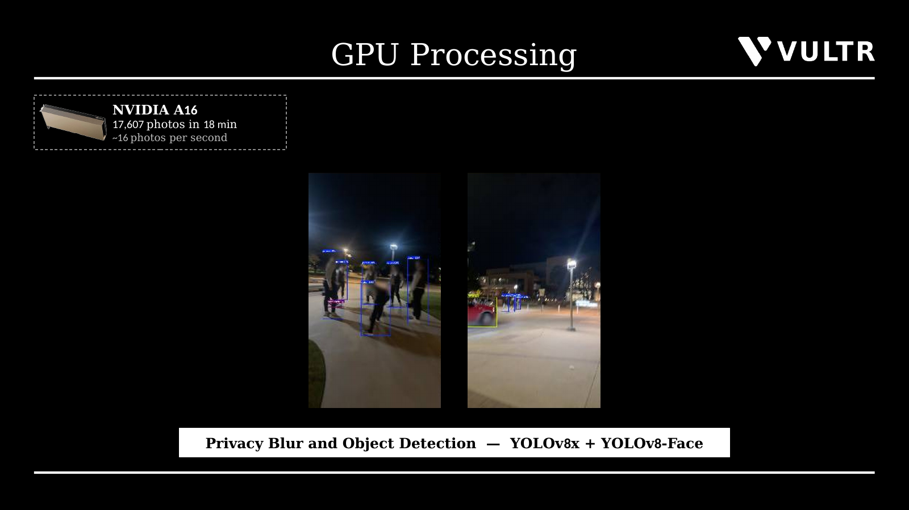
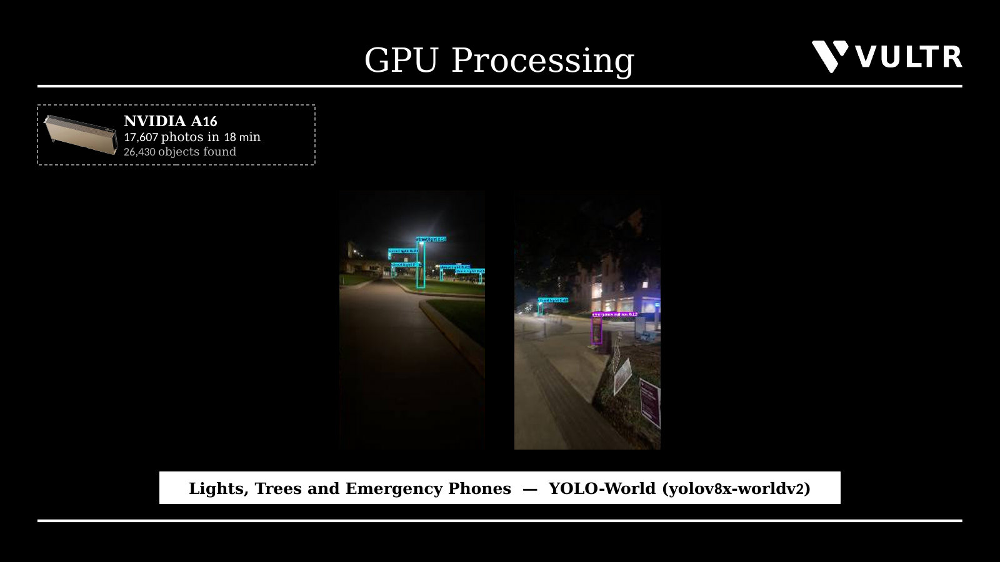
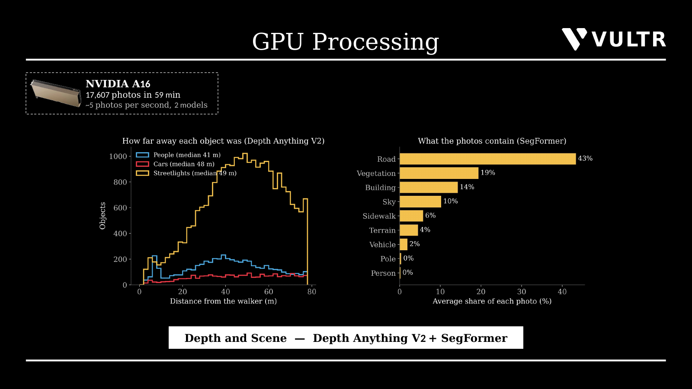
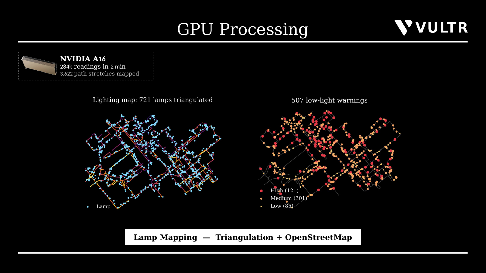
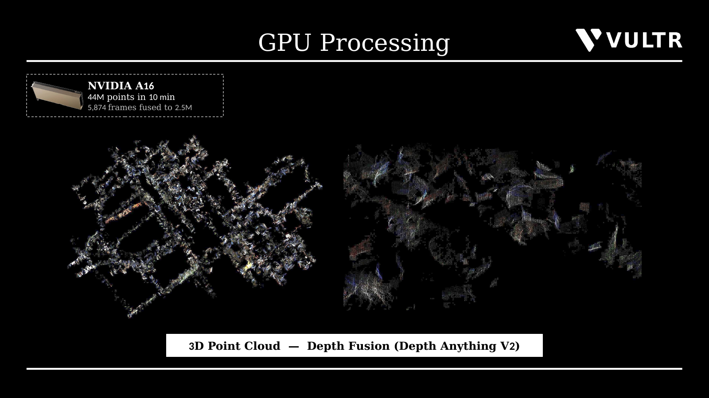

## MongoDB Atlas

Database `lux_survey` on Cluster0 (AWS). Screenshots taken from Atlas Data Explorer.

| # | Slide | Documents · data size |
|---|---|---|
| 1 | Atlas cluster | 73,407 · 18.88 MB |
| 2 | readings | 17,715 · 3.51 MB |
| 3 | segments | 3,622 · 985 kB |
| 4 | routes and bins | 6,457 bins · 1.39 MB |
| 5 | walks and photos | 17,289 photos · 5.36 MB |
| 6 | detections | 9,334 · 2.96 MB |
| 7 | Location queries | 31 indexes |

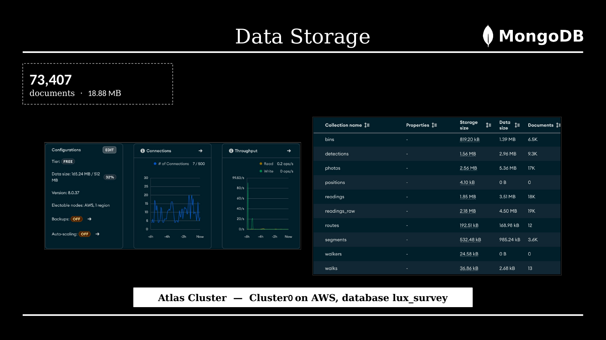
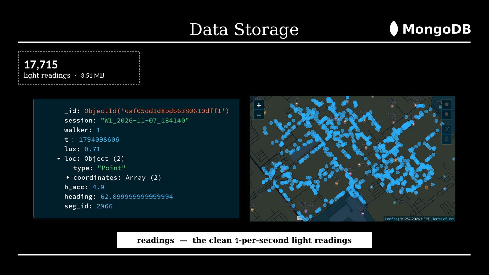
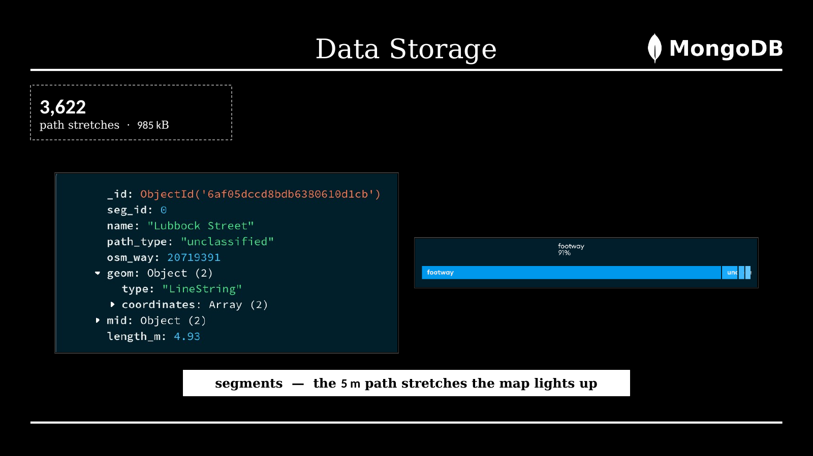
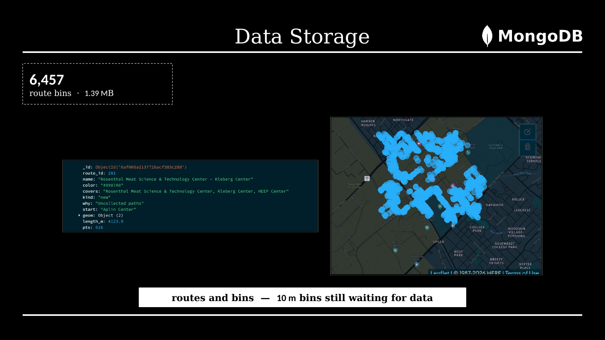
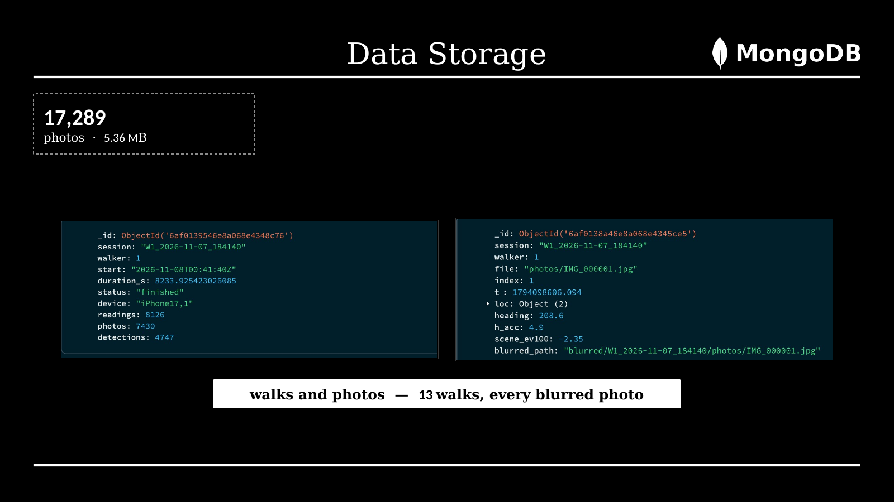
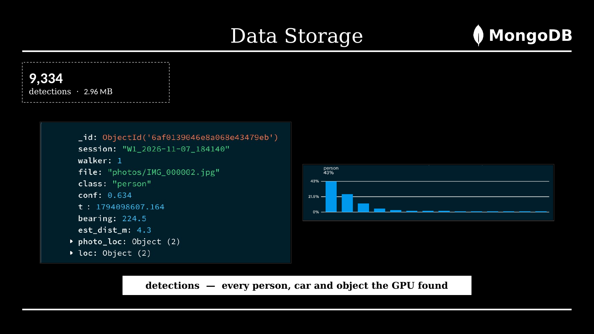
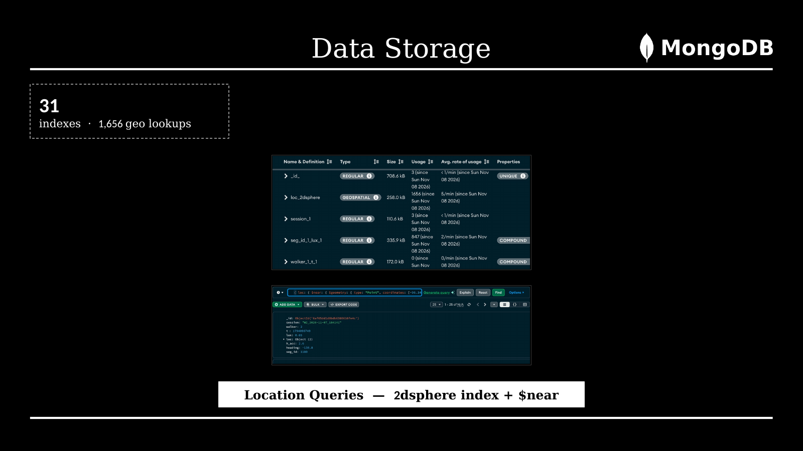
